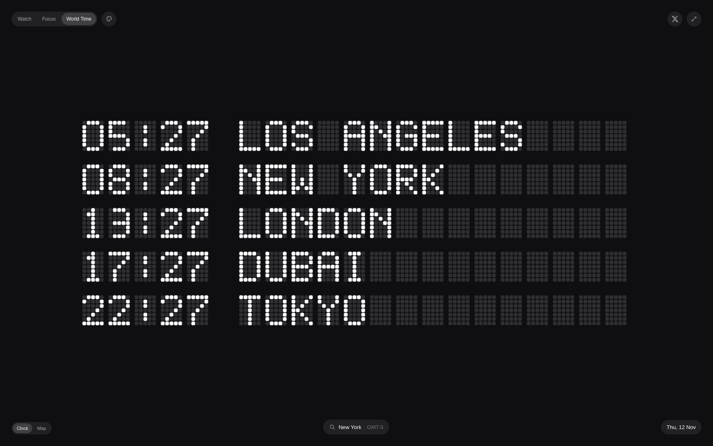
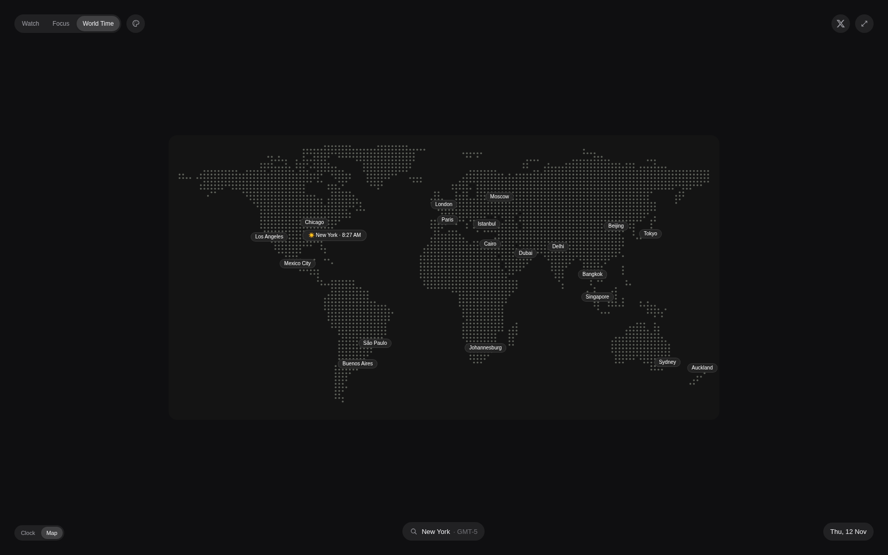
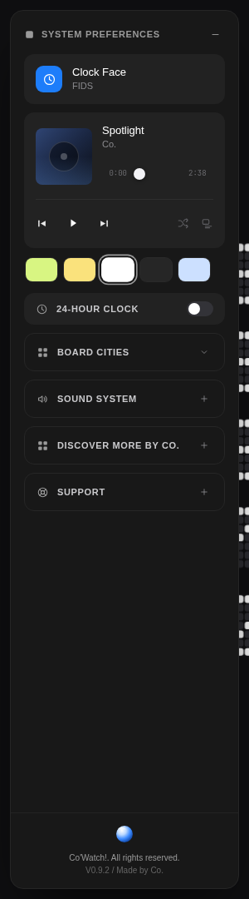
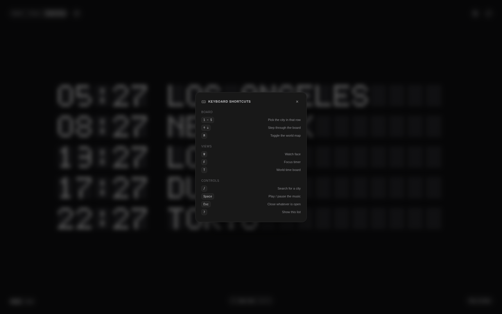
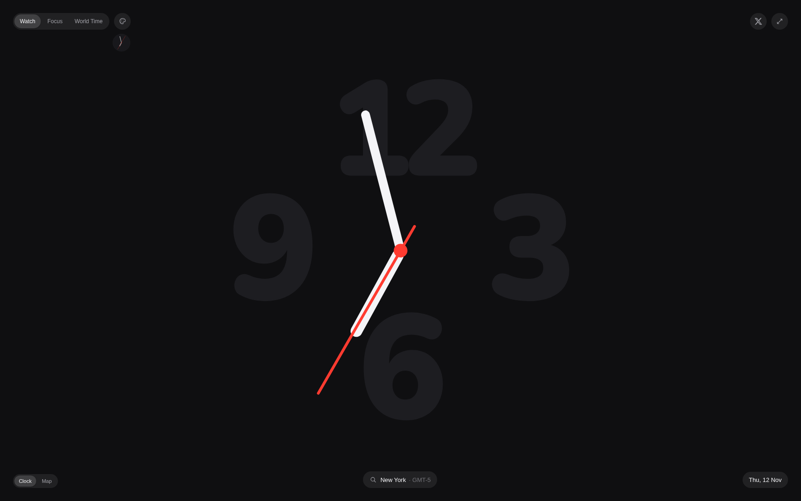

# Airport Time — LED Matrix Studio

A pixel-faithful recreation of the Apple Watch **World Time** face, rebuilt for the
web as a full-screen LED departure board with a dot-matrix world map and a
`SYSTEM PREFERENCES` drawer.



| | | | |
| --- | --- | --- | --- |
|  |  |  |  |
| The dot-matrix world map | The SYSTEM PREFERENCES drawer | Keyboard shortcuts | The analog watch face |

Everything you see was reverse-engineered from a 1728×1080 60 fps reference
recording: the 5×7 dot-matrix font, the exact cell rhythm, the unlit "off" dot
field, the chrome geometry and the palette were all sampled pixel-by-pixel off
the source frames rather than eyeballed.

> ### Inspiration
>
> The original airport-matrix concept — a departure board that shows the local
> time of every city so you never miss your flight — comes from
> [HASSCO© (@itshassco)](https://x.com/itshassco/status/2106761271282737292).
> This project rebuilds that idea as a working web app, with a real world map,
> a keyboard-driven interface and a split-flap board.
>
> The board itself is modelled on the Apple Watch **World Time** face.

## Stack

- **Next.js 16** (App Router, React 19.2, TypeScript strict, Turbopack)
- **Tailwind CSS v4**
- **framer-motion** for the segmented control, accordions and view transitions
- **Web Audio API** for the tick/confirm tones, and an `<audio>` element for
  the music player
- `Intl.DateTimeFormat` + IANA time zones for every clock (no hand-rolled maths)

```bash
npm install
npm run dev      # http://localhost:3000
npm run build && npm start
npm run typecheck
```

> **Note:** `next dev` and `next build` now write to separate output
> directories (`.next/dev` and `.next`), so you can keep the dev server
> running while you build. If you ever see a stale asset 404 in the console,
> restart the dev server.

## What's in it

| Face | What it does |
| --- | --- |
| **Watch** | Oversized, barely-there numerals with high-contrast hands sweeping over them, plus a live mini preview. |
| **Focus** | A dot-matrix countdown with a progress ring, presets and start/pause/reset. |
| **World Time** | The LED departure board: five cities, live clocks, a scrolling marquee for long names, a searchable city list and a dot-matrix world map. |

Picking a city on the board (or on the map, or from the search) **highlights that
row and dims the rest**, so the selected departure reads instantly.

### The board

`lib/dotFont.ts` holds a 5×7 LED font. Each glyph is 7 rows of 5 cells; `#` is a
lit dot and `.` an unlit one. Glyphs live in a 5-column box and boxes are laid
out on a 6-column rhythm (5 columns + 1 column of gap) — that "five dots then a
breath" texture is what makes the board read as a real LED matrix.

The board is drawn as one SVG:

- a single `<pattern>` of 5×7 unlit dots, tiled into two fields — the clock
  block on the left and the city block on the right — with a blank gutter
  between them, exactly like the reference;
- lit dots drawn per glyph on top, landing on precisely the same lattice.

Long city names scroll seamlessly by rendering two copies of the name inside a
`clipPath` that confines them to the city field, and translating the group by
exactly one name-pitch — in SVG user units, so it stays resolution independent.

### The map

The `Clock / Map` toggle swaps the board for a dot-matrix world map:

- a **150 × 75** land bitmap rasterised from Natural Earth 50m coastlines
  (`lib/worldmap.ts`), drawn as tiny circular dots on a `#141414` canvas;
- isolated ocean specks are filtered out, so the Pacific stays empty;
- every one of the **twenty global hubs** carries a translucent pill badge
  (`rgba(38,38,38,0.85)` + a 6px backdrop blur) pinned over its city;
- the selected city's badge expands to show a sun or moon and its live local
  time, e.g. `🌙 Singapore · 3:16 AM`;
- badges that would collide are nudged apart automatically.

### The drawer

`SYSTEM PREFERENCES` slides in as a fixed 276px left drawer (rounded 16px,
`#181818` on a `#262626` hairline) and hides the face switcher and the
`Clock / Map` pills while it is open. It contains:

- the **Clock Face** card (Digital ⇄ FIDS);
- the **lo-fi player** — a real generative Web Audio engine with a chord pad,
  a vinyl-noise bed, shuffle, a queue and its own volume;
- the five **theme swatches** (Pastel Lime, Warm Yellow, White, Dark Charcoal,
  Ice Blue) which re-tint the board and the canvas;
- the **SOUND SYSTEM** accordion with a `Mute / System / Watch` switch and two
  pill sliders for system and music volume;
- **DISCOVER MORE BY CO.** and **SUPPORT** accordions;
- the pinned brand footer.

## Rendering the live clock

The page is server-rendered per request. The server hands the exact instant it
rendered to the client, and `useSyncExternalStore` uses that value for both the
server markup and the first client render, so hydration never mismatches — and
the very first paint already shows the correct time instead of a placeholder.

## Error handling

`lib/clientGuard.ts` renders a tiny inline script into the document head. It
installs an `unhandledrejection` listener **before any client bundle loads**,
which matters because React 19 gives every resource it preloads a promise that
is rejected with the DOM **error event** when the resource fails to load — and
nothing awaits that promise, so it surfaces as an unhandled rejection and the
Next.js dev overlay renders it as a bare `Runtime Error: [object Event]`.

The guard logs those rejections in full (type, own properties, creation stack)
so nothing is silently swallowed, and keeps them out of the overlay. Genuine
application errors are left completely alone — they still reach React's error
boundary and the dev overlay exactly as they should.

`app/error.tsx` and `app/global-error.tsx` are the two error boundaries. The
route boundary renders its fallback in the app's own dot-matrix language — an
"ERROR / TRY AGAIN" panel with a retry that re-renders the segment — so a
failure looks like the board going out of order rather than a blank white
page. The global boundary covers failures in the root layout itself and
renders its own document, as the framework requires.

## Preferences

Everything the user can change — the palette, the board rendering, the sound
mode and volumes, the 24-hour clock, the board's city list, the starred
cities and the current location — lives in one object that is mirrored into
`localStorage` by `lib/preferences.ts`.

Two details matter:

- **The stored copy is read after the first render, never during it.** The
  page is server-rendered per request, so reading `localStorage` in the
  render would desynchronise the server markup from the client tree. The
  first paint always uses the defaults; the stored values are applied in an
  effect right after hydration.
- **Every field is validated on the way back in.** Storage is user-editable
  and survives across deploys, so a corrupt or outdated value falls back to
  its default rather than crashing the app.

The palette is additionally applied by a tiny inline script in the document
head, so a returning visitor never sees a flash of the default theme before
React hydrates.

## Keyboard shortcuts

The board is a tool you leave running, so it is drivable without the mouse.
Press `?` for the list.

| Key | Action |
| --- | --- |
| `1` – `5` | Pick the city in that board row |
| `↑` `↓` | Step through the board |
| `M` | Toggle the world map |
| `W` `F` `T` | Watch face / focus timer / world time board |
| `/` | Search for a city |
| `Space` | Play or pause the music |
| `Esc` | Close whatever is open |
| `?` | Show the shortcut list |

Shortcuts never fire while the user is typing in a field, and never hijack a
modifier combination the browser or the OS owns.

## The split-flap

The clock field flips like a mechanical board: each character is split into a
top and a bottom half, the top half falls away, and the new character
unfolds behind it.

The whole effect rests on one detail — the pivot. Each half is its own `<g>`
with `transform-box: fill-box`, and a transparent pad rectangle pins the
group's fill box to the half-cell. Without it the hinge would sit on
whichever dots happened to be lit, and the flip would wobble from glyph to
glyph. With it, both halves hinge on exactly the split line, which is
verified by measuring the rendered geometry as the animation runs.

The characters flip in sequence, and the stagger is relative to the first
character that changed rather than to its position in the string — so when
only the minute digit rolls over, it flips immediately instead of waiting.

## Layout

```
app/
  globals.css        design tokens, theme palettes, animations
  layout.tsx         fonts, metadata, the inline guard + theme boot
  page.tsx
  error.tsx          the route error boundary (dot-matrix fallback)
  global-error.tsx   the root error boundary
  manifest.ts        the web app manifest
  icon.svg / favicon.ico / apple-icon.png
components/
  Studio.tsx         state, theme, sound, layout, shortcuts
  WorldTimeBoard.tsx the LED board + the digital rendering
  FlapChar.tsx       one split-flap character
  WorldMap.tsx       the dot-matrix world map and its badges
  BoardLayout.tsx    the board's city list and the favourites
  ShortcutSheet.tsx  the keyboard shortcut list
  DotMatrix.tsx      dot text + dot field primitives
  AnalogWatch.tsx    the watch face
  FocusView.tsx      the focus timer
  PreferencesPanel.tsx the SYSTEM PREFERENCES drawer
  TopBar.tsx / BottomBar.tsx / Segmented.tsx / GlassButton.tsx / Icons.tsx
lib/
  dotFont.ts         the 5x7 font
  cities.ts          227 cities with IANA zones and coordinates
  mapCities.ts       the twenty hubs shown on the map
  time.ts            timezone maths, GMT labels, formatting
  theme.ts           the board palettes
  preferences.ts     the persisted preferences and their validation
  useCities.ts       favourites and the board layout
  useKeyboardShortcuts.ts
  worldmap.ts        the 150x75 land bitmap
  lofi.ts            the generative lo-fi engine
  useNow.ts          a clock that re-aligns to the wall clock every second
```

## Accessibility

Every control is a real focusable element with an accessible name, the board
rows respond to Enter/Space, the map badges are buttons, the drawer uses radio
groups for its single-choice controls, and `prefers-reduced-motion` disables the
marquee and the entrance animations.

---

## Future improvements and features

A roadmap of what would come next, roughly in the order it would be worth
building.

**Board and typography**

1. **A second font.** The 5×7 dot font is the reference's — a 5×9 "tall" face
   would let the board switch between an airline-departure look and a
   high-contrast one, the way real FIDS boards do.
2. **Per-row status colours.** Blue for "boarding", amber for "delayed",
   red for "cancelled" — with a legend in the drawer.
3. **Configurable row count.** Let the board show 3, 5 or 8 cities depending on
   the viewport instead of always filling five rows.
4. **A live seconds column**, blinking on the beat, for people who want the
   precision.

**Map**

5. **Sun-path overlay.** A terminator line across the map so you can see where
   it is night right now, instead of only inferring it from each badge.
6. **Zoom and pan.** Pinch or scroll to zoom into a region; the badges would
   declutter as you zoom in.
7. **Timezone bands.** Fill the map with subtle colour bands for each UTC
   offset, so the whole world's rhythm reads at a glance.
8. **A bigger land dataset.** Swap Natural Earth 50m for 10m at higher zoom
   levels, and render the coastline as a real polyline rather than dots.

**Preferences drawer**

9. **A real clock-face picker.** Right now the Clock Face card toggles
   Digital/FIDS; it could offer a gallery of faces instead.
10. **Per-city custom layouts.** Let a city be pinned to a board slot, given a
    nickname, or reordered.
11. **More lo-fi tracks**, plus an equaliser and a sleep timer.
12. **An appearance section** for the chrome itself — the drawer's colours,
    the corner radius, the density of the layout.

**Product**

13. **A watch face for the real thing.** The same board, the same font, running
    as a watchOS complication or a standalone watch app.
14. **Alerts.** A city can be starred and the app can notify you when it is
    midnight there, or when a saved flight lands.
15. **Fullscreen "signage" mode.** A kiosk-friendly layout with no chrome at
    all, driven by a URL parameter, for a lobby screen.
16. **Offline support.** A service worker so the board keeps ticking with no
    network.
17. **More cities.** The catalogue has 227; the world's capitals and time-zone
    capitals are still missing.
18. **Shareable board snapshots.** Render the current board to a PNG so it can
    be posted.
